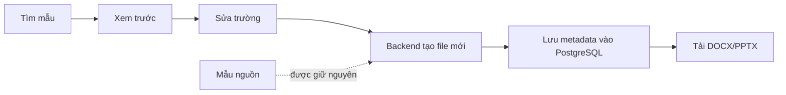
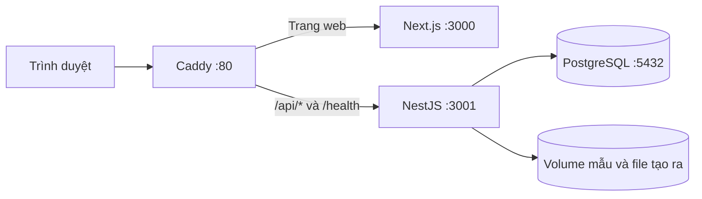

# Papertrail — Thư viện mẫu tài liệu

Papertrail giúp người dùng **tìm mẫu, xem trước, sửa nội dung theo trường có sẵn và tải xuống DOCX/PPTX**. Đây là MVP full-stack phục vụ bài đánh giá tuyển dụng.

## Dùng thử ngay

🌐 **Website demo:** [https://papertrail-dev.duckdns.org/](https://papertrail-dev.duckdns.org/)

### Chạy trên máy bằng Docker

Chỉ cần Git và Docker có Docker Compose. Không cần cài Node.js, Python hay PostgreSQL trên máy.

```bash
git clone https://github.com/tranchien2105/document-template-library.git
cd document-template-library
docker compose up --build
```

Mở <http://localhost:3000>. Lần chạy đầu, Docker cần Internet để tải image và build ứng dụng; có thể mất vài phút. Nếu cổng 3000, 3001 hoặc 5432 đang được ứng dụng khác dùng, hãy dừng ứng dụng đó trước.

Nhấn `Ctrl+C` để dừng. `docker compose down` xóa container nhưng giữ dữ liệu. **Không chạy `docker compose down -v`** nếu cần giữ database và các file đã tạo.

## Có gì trong Papertrail?

| Sản phẩm | Chức năng |
| --- | --- |
| Thư viện DOCX | Tìm kiếm, lọc, xem trước, sửa trường mẫu, tạo và tải DOCX |
| Thư viện PPTX | Tìm kiếm, lọc, xem các slide, điền trường, tạo bản sao và tải PPTX |
| Quản lý mẫu | Tải DOCX/PPTX lên, sửa thông tin, cập nhật thumbnail hoặc ẩn mẫu |
| Tài liệu của tôi | Xem và tải các file đã tạo |

Kho mẫu khởi tạo gồm **5 DOCX và 3 PPTX**. Thư viện đọc danh sách từ backend và PostgreSQL, không khai báo cứng từng thẻ mẫu trong giao diện.

### DOCX

| Mẫu | Danh mục |
| --- | --- |
| Báo cáo kết quả kinh doanh | Kinh doanh |
| Hồ sơ ứng tuyển | Nghề nghiệp |
| Đơn xin nghỉ phép | Nhân sự |
| Biên bản cuộc họp | Vận hành |
| Đề xuất dự án | Dự án |

### PPTX

| Bộ slide | Số slide |
| --- | ---: |
| Giới thiệu công ty | 6 |
| Đánh giá kết quả kinh doanh theo quý | 6 |
| Kế hoạch triển khai dự án | 7 |

### Hình ảnh mẫu

<p align="center">
  
  
</p>

## Luồng tạo file



Trong môi trường production, Caddy nhận yêu cầu HTTP và chuyển tiếp tới Next.js hoặc NestJS. PostgreSQL, frontend và backend không mở cổng trực tiếp ra Internet.



## Công nghệ và dữ liệu

- **Frontend:** Next.js, React, TypeScript.
- **Backend:** NestJS, TypeORM; API REST.
- **Cơ sở dữ liệu:** PostgreSQL; migration tạo schema và Demo User khi backend khởi động.
- **Tạo file:** `docx`, `pptxgenjs`; JSZip xử lý placeholder trong gói Office Open XML.
- **Lưu trữ:** mẫu và file tạo ra ở các thư mục riêng; Docker Compose dùng volume để giữ dữ liệu.

Chi tiết endpoint, ví dụ request và mô hình `Template` – `Document` – `User`: [docs/API.md](docs/API.md). Danh sách mẫu, placeholder và cách đăng ký mẫu mới: [docs/template-manifest.md](docs/template-manifest.md).

## Kiểm tra code

Chạy tại thư mục gốc:

```bash
npm run typecheck
npm run lint
npm test
npm run build
```

Test backend kiểm tra upload Office, placeholder, XML, bảo toàn file nguồn, sao chép PPTX, metadata và lỗi tải file. Test đơn vị không cần PostgreSQL; kiểm tra tích hợp database cần chạy riêng.

## Giới hạn cần biết

- Đây là bản demo dùng chung một Demo User; **chưa có đăng nhập hay cách ly dữ liệu nhiều người dùng**.
- DOCX sửa được các trường do template định nghĩa, chưa phải trình soạn thảo Word tự do.
- Không có PowerPoint editor tích hợp. Có thể sửa file PPTX đã tải bằng PowerPoint hoặc ứng dụng tương thích.
- Preview được tái dựng từ dữ liệu bên trong DOCX/PPTX, không phải ảnh render nguyên bản; cách xuống dòng, font và hiệu ứng có thể khác ứng dụng Office.
- Upload có kiểm tra định dạng và cấu trúc gói Office, nhưng không thay thế antivirus.

## Tài liệu và bàn giao

- [Chạy thử cho người mới](docs/HUONG-DAN-CHAY-CHO-NGUOI-MOI.md)
- [Kịch bản quay demo 3–5 phút](docs/DEMO.md)
- [Triển khai Ubuntu VPS](docs/DEPLOYMENT-UBUNTU.md)
- [API và mô hình dữ liệu](docs/API.md)
- [Bảo mật và giới hạn](docs/SECURITY.md)
- [Checklist bàn giao](docs/HANDOVER.md)

Các thư viện mã nguồn mở chính gồm Next.js, NestJS, TypeORM, JSZip, `docx` và `pptxgenjs`; giấy phép được ghi trong [docs/API.md](docs/API.md). OpenAI Codex được dùng hỗ trợ triển khai, rà soát và kiểm tra; code và kết quả cần được chủ dự án tự đánh giá trước khi nộp.
