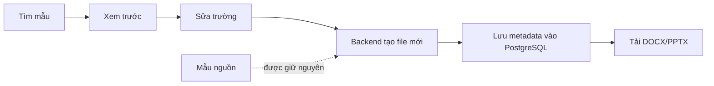
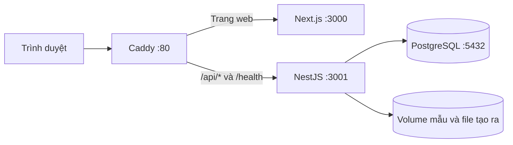

# Papertrail — Thư viện mẫu tài liệu

Papertrail là ứng dụng web để **tìm mẫu, xem trước, điền nội dung và tải tài liệu DOCX/PPTX**. Đây là sản phẩm cho bài kiểm tra tuyển dụng Fullstack.

## Dùng thử ngay

🌐 **Website demo:** [https://papertrail-dev.duckdns.org/](https://papertrail-dev.duckdns.org/)

### Chạy trên máy bằng Docker

Chỉ cần Git và Docker có Docker Compose. Không cần cài Node.js, Python hay PostgreSQL trên máy.

```bash
git clone https://github.com/tranchien2105/document-template-library.git
cd document-template-library
docker compose up --build
```

Mở <http://localhost:3000>. Lần chạy đầu, Docker cần Internet để tải image và build ứng dụng; có thể mất vài phút. Nếu cổng 3000, 3001 hoặc 5432 đang được ứng dụng khác dùng, hãy dừng ứng dụng đó trước.

Nhấn `Ctrl+C` để dừng. `docker compose down` xóa container nhưng giữ dữ liệu. **Không chạy `docker compose down -v`** nếu cần giữ database và các file đã tạo.

## Có gì trong Papertrail?

| Sản phẩm | Chức năng |
| --- | --- |
| Thư viện DOCX | Tìm kiếm, lọc, xem trước, sửa trường mẫu, tạo và tải DOCX |
| Thư viện PPTX | Tìm kiếm, lọc, xem các slide, điền trường, tạo bản sao và tải PPTX |
| Quản lý mẫu | Tải DOCX/PPTX lên, sửa thông tin, cập nhật thumbnail hoặc ẩn mẫu |
| Tài liệu của tôi | Xem và tải các file đã tạo |

Ứng dụng có sẵn **5 mẫu DOCX và 3 mẫu PPTX**. Backend lấy thông tin ban đầu từ manifest và lưu vào PostgreSQL. Khi thêm mẫu qua trang Quản lý mẫu, thư viện hiển thị mẫu đó từ API mà không cần sửa giao diện.

### DOCX

| Mẫu | Danh mục |
| --- | --- |
| Báo cáo kết quả kinh doanh | Kinh doanh |
| Hồ sơ ứng tuyển | Nghề nghiệp |
| Đơn xin nghỉ phép | Nhân sự |
| Biên bản cuộc họp | Vận hành |
| Đề xuất dự án | Dự án |

### PPTX

| Bộ slide | Số slide |
| --- | ---: |
| Giới thiệu công ty | 6 |
| Đánh giá kết quả kinh doanh theo quý | 6 |
| Kế hoạch triển khai dự án | 7 |

### Hình ảnh mẫu

<p align="center">
  
  
</p>

## Luồng tạo file



Trong môi trường production, Caddy nhận yêu cầu HTTP và chuyển tiếp tới Next.js hoặc NestJS. PostgreSQL, frontend và backend không mở cổng trực tiếp ra Internet.



## Công nghệ và dữ liệu

- **Frontend:** Next.js, React, TypeScript.
- **Backend:** NestJS, TypeORM; API REST.
- **Cơ sở dữ liệu:** PostgreSQL. Backend tự chạy migration và tạo tài khoản Demo User khi khởi động lần đầu.
- **Tạo file:** `docx`, `pptxgenjs`; JSZip xử lý placeholder trong gói Office Open XML.
- **Lưu trữ:** mẫu và file tạo ra ở các thư mục riêng; Docker Compose dùng volume để giữ dữ liệu.

Danh sách API, ví dụ request và mô hình `Template` – `Document` – `User` nằm trong [docs/API.md](docs/API.md). Cách đăng ký mẫu và các trường có thể điền được mô tả trong [docs/template-manifest.md](docs/template-manifest.md).

## Kiểm tra code

Chạy tại thư mục gốc:

```bash
npm run typecheck
npm run lint
npm test
npm run build
```

Test backend bao phủ upload Office, thay placeholder, xử lý XML, giữ nguyên file mẫu, sao chép PPTX, lưu metadata và tải file. Các test đơn vị không cần PostgreSQL; kiểm tra database cần một môi trường PostgreSQL riêng.

## Giới hạn cần biết

- Mọi tài liệu hiện được gắn với một Demo User; **chưa có đăng nhập hay dữ liệu riêng cho từng người dùng**.
- DOCX sửa được các trường do template định nghĩa, chưa phải trình soạn thảo Word tự do.
- Chưa có trình sửa slide tích hợp. Có thể sửa file PPTX đã tải bằng PowerPoint hoặc ứng dụng tương thích.
- Bản xem trước được tạo từ dữ liệu trong DOCX/PPTX, không phải ảnh chụp trực tiếp từ Office. Cách xuống dòng, phông chữ và hiệu ứng có thể hiển thị khác.
- Tệp tải lên được kiểm tra định dạng và cấu trúc Office. Việc kiểm tra này không thay thế công cụ quét mã độc.

## Tài liệu và bàn giao

- [Hướng dẫn chạy ứng dụng](docs/HUONG-DAN-CHAY-CHO-NGUOI-MOI.md)
- [Hướng dẫn triển khai Ubuntu VPS](docs/DEPLOYMENT-UBUNTU.md)
- [API và mô hình dữ liệu](docs/API.md)
- [Bảo mật và giới hạn](docs/SECURITY.md)
