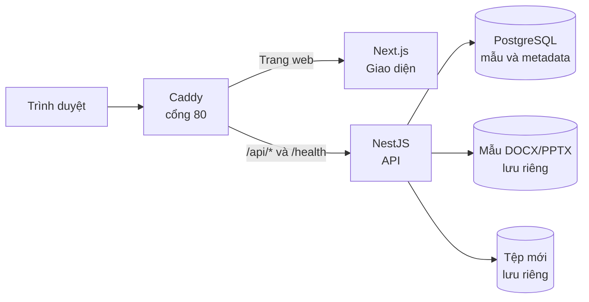
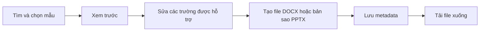

# Papertrail

Thư viện mẫu giúp tìm, xem trước và tạo tài liệu **DOCX** hoặc bản trình chiếu **PPTX** bằng tiếng Việt.

## Dùng thử

🌐 **Demo trực tuyến:** [papertrail-dev.duckdns.org](https://papertrail-dev.duckdns.org/)

Chạy trên máy bằng Docker:

```bash
git clone https://github.com/tranchien2105/document-template-library.git
cd document-template-library
docker compose up --build -d
```

Mở **http://localhost:3000**. Lần chạy đầu cần Internet để tải và build các image. Không cần cài Node.js, Python hay PostgreSQL trên máy.

Để dừng ứng dụng mà giữ dữ liệu: `docker compose down`. **Không thêm `-v`** nếu bạn muốn giữ database và file đã tạo.

## Papertrail hoạt động như thế nào?

**Sơ đồ production:**





File được tạo riêng; mẫu gốc không bị sửa. DOCX chỉnh sửa qua các trường của mẫu. PPTX có thể tải xuống để chỉnh sửa bằng PowerPoint hoặc ứng dụng tương thích.

## Một vài mẫu

<p align="center">
  
  
</p>

**Kho mẫu khởi tạo:** 5 DOCX và 3 PPTX. Danh sách được quản lý bằng manifest, giao diện tải dữ liệu từ backend.

## Công nghệ

- **Frontend:** Next.js, React, TypeScript.
- **Backend:** NestJS, TypeORM, PostgreSQL.
- **Tài liệu:** JSZip, `docx`, `pptxgenjs`; file lưu trên filesystem Docker volume.
- **AI:** OpenAI Codex được dùng hỗ trợ viết, rà soát và kiểm tra code.

## Kiểm tra

```bash
npm run typecheck
npm run lint
npm test
npm run build
```

## Giới hạn hiện tại

- Chưa có đăng nhập; đây là bản demo dùng chung một Demo User.
- DOCX chỉ sửa các trường khai báo trong mẫu; chưa phải trình soạn thảo Word đầy đủ.
- Không có trình sửa slide tích hợp. Bản xem trước được dựng từ cấu trúc Office, có thể khác cách Word/PowerPoint hiển thị.

## Tài liệu khác

- [Hướng dẫn cho người mới chạy bằng Docker](docs/HUONG-DAN-CHAY-CHO-NGUOI-MOI.md)
- [Triển khai lên Ubuntu VPS](docs/DEPLOYMENT-UBUNTU.md)
- [API và mô hình dữ liệu](docs/API.md)
- [Danh sách mẫu và cách bổ sung mẫu](docs/template-manifest.md)
- [Kịch bản demo](docs/DEMO.md) · [Checklist bàn giao](docs/HANDOVER.md)
- [Các giới hạn và kiểm soát bảo mật](docs/SECURITY.md)
