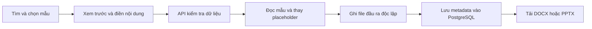
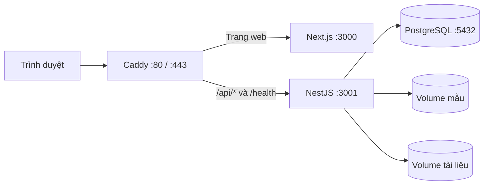

# Papertrail — Thư viện mẫu tài liệu

Papertrail là ứng dụng web quản lý và tạo tài liệu từ mẫu Word và PowerPoint. Hệ thống tập trung các bước tìm kiếm, xem trước, điền nội dung và xuất file DOCX/PPTX trong cùng một giao diện, phục vụ các nhu cầu như lập báo cáo, chuẩn bị hồ sơ, ghi nhận cuộc họp và xây dựng bài thuyết trình.

Dự án gồm frontend Next.js, backend NestJS và cơ sở dữ liệu PostgreSQL. Mẫu tài liệu được quản lý qua API; mỗi lần tạo tài liệu sinh một file độc lập và lưu thông tin vào cơ sở dữ liệu để tra cứu, tải lại.

**Website demo:** [papertrail-dev.duckdns.org](https://papertrail-dev.duckdns.org/)

## Chức năng chính

| Nhóm chức năng | Nội dung |
| --- | --- |
| Thư viện mẫu | Phân loại Word/PowerPoint; tìm kiếm theo từ khóa; lọc theo danh mục; phân trang kết quả |
| Xem trước | Hiển thị nội dung DOCX và các slide PPTX trước khi tạo tài liệu |
| Tạo tài liệu Word | Điền các trường được khai báo trong mẫu, kiểm tra dữ liệu đầu vào và xuất DOCX |
| Tạo bài thuyết trình | Điền các placeholder được hỗ trợ và tạo bản PPTX độc lập từ mẫu nguồn |
| Quản lý mẫu | Tải DOCX/PPTX lên; cập nhật tên, mô tả, danh mục và thumbnail; ẩn mẫu khỏi thư viện |
| Lịch sử tài liệu | Liệt kê và tải lại các file đã tạo tại trang **Tài liệu của tôi** |
| Khởi tạo dữ liệu | Tự chạy migration và đồng bộ bộ mẫu đi kèm khi backend khởi động |

Phiên bản hiện tại sử dụng chung một **Demo User**, chưa có đăng nhập hoặc phân quyền. Trang quản lý mẫu và lịch sử tài liệu thuộc phạm vi dùng thử chung.

## Quy trình sử dụng

### Tạo tài liệu từ mẫu

1. Chọn thư viện Word hoặc PowerPoint và tìm mẫu theo tên hoặc danh mục.
2. Mở trang chi tiết để xem trước nội dung và các trường có thể chỉnh sửa.
3. Nhập nội dung vào biểu mẫu; các trường bắt buộc và giới hạn dữ liệu được kiểm tra trước khi tạo file.
4. Tạo tài liệu và tải file DOCX/PPTX về máy.
5. Truy cập **Tài liệu của tôi** để xem lại danh sách tài liệu và tải lại khi cần.

File tải về có thể tiếp tục chỉnh sửa bằng Word, PowerPoint hoặc phần mềm tương thích. File mẫu nguồn được giữ nguyên qua các lần tạo tài liệu.

### Bổ sung và quản lý mẫu

1. Truy cập **Quản lý mẫu**, chọn loại Word hoặc PowerPoint.
2. Tải file lên kèm tên, mô tả và danh mục.
3. Cập nhật thumbnail hoặc thông tin mô tả sau khi mẫu được tạo.
4. Kiểm tra mẫu trong thư viện và tạo tài liệu từ các trường hệ thống nhận diện.

Mẫu mới được lưu vào PostgreSQL và hiển thị qua API, không yêu cầu sửa giao diện hoặc cập nhật manifest. Chức năng ẩn mẫu ngừng hiển thị mẫu trong thư viện và giữ lại file nguồn.

## Bộ mẫu đi kèm

Dữ liệu khởi tạo gồm **5 mẫu DOCX và 3 mẫu PPTX**, được khai báo trong [manifest.json](storage/templates/manifest.json).

| Loại | Tên mẫu | Danh mục / Số slide |
| --- | --- | --- |
| DOCX | Báo cáo kết quả kinh doanh | Kinh doanh |
| DOCX | Hồ sơ ứng tuyển | Nghề nghiệp |
| DOCX | Đơn xin nghỉ phép | Nhân sự |
| DOCX | Biên bản cuộc họp | Vận hành |
| DOCX | Đề xuất dự án | Dự án |
| PPTX | Giới thiệu công ty | 6 slide |
| PPTX | Đánh giá kết quả kinh doanh theo quý | 6 slide |
| PPTX | Kế hoạch triển khai dự án | 7 slide |

<p align="center">
  
  
</p>

[Bộ mẫu nhân sự bổ sung](storage/template-upload-samples/hr/README.md) gồm kế hoạch tuyển dụng, phiếu đánh giá phỏng vấn, chiến lược thu hút nhân tài và chương trình hội nhập nhân sự mới. Bộ này có 2 DOCX, 2 PPTX và thumbnail tương ứng, phục vụ kiểm tra chức năng tải mẫu lên; không tự động được thêm vào thư viện khi khởi động.

## Công nghệ sử dụng

| Thành phần | Công nghệ | Vai trò |
| --- | --- | --- |
| Giao diện | Next.js 16, React 19, TypeScript | Thư viện mẫu, trang chi tiết, biểu mẫu nhập liệu và quản lý tài liệu |
| API | NestJS 11, TypeScript | Xử lý nghiệp vụ, kiểm tra đầu vào, quản lý mẫu và tạo file |
| Truy cập dữ liệu | TypeORM | Ánh xạ thực thể, truy vấn và migration |
| Cơ sở dữ liệu | PostgreSQL 16 | Lưu metadata mẫu, tài liệu và Demo User |
| Xử lý file Office | JSZip, Office Open XML | Đọc cấu trúc DOCX/PPTX và thay placeholder trong file nguồn |
| Sinh bộ mẫu | `docx`, `pptxgenjs` | Tạo các file mẫu thông qua script |
| Đóng gói | Docker, Docker Compose | Chạy frontend, backend và database trong các dịch vụ riêng |
| Triển khai | Caddy | Reverse proxy và HTTPS cho cấu hình production |

Các phiên bản dependency cụ thể được lưu trong [package-lock.json](package-lock.json).

## Kiến trúc và xử lý dữ liệu

### Luồng tạo tài liệu



Backend đọc file mẫu, thay các trường được khai báo và ghi kết quả vào thư mục đầu ra riêng. Mỗi tài liệu có UUID để liên kết bản ghi với file đã tạo. Khi lưu metadata thất bại, file đầu ra được dọn dẹp để tránh tồn tại file không có bản ghi tương ứng.

### Mô hình dữ liệu

| Thực thể | Thông tin chính | Quan hệ |
| --- | --- | --- |
| `Template` | Tên, slug, loại, danh mục, đường dẫn mẫu, thumbnail và dữ liệu xem trước | Một mẫu có nhiều tài liệu được tạo |
| `Document` | UUID, mẫu nguồn, người sở hữu, tên file, đường dẫn, dữ liệu biểu mẫu và thời gian tạo/cập nhật | Thuộc một mẫu và một người dùng |
| `User` | Tên và email | Sở hữu các tài liệu đã tạo; hiện sử dụng Demo User |

PostgreSQL lưu metadata; nội dung file nằm trong hệ thống lưu trữ riêng. TypeORM tự chạy migration khi khởi động và tắt `synchronize` để quản lý thay đổi cấu trúc dữ liệu qua migration.

Manifest cung cấp dữ liệu cho các mẫu đi kèm. Quá trình đồng bộ có thể chạy lại mà không tạo bản ghi trùng và giữ lại metadata đã chỉnh sửa qua trang quản lý. Mẫu tải lên qua giao diện được quản lý trực tiếp trong database.

### Kiểm tra file và dữ liệu

- File tải lên được kiểm tra phần mở rộng, cấu trúc ZIP và các thành phần Office bắt buộc; giới hạn mặc định là **10 MiB/file**.
- Bộ kiểm tra giới hạn số mục và dung lượng giải nén, đồng thời từ chối các thành phần bị cấm như macro, ActiveX và file thực thi nhúng.
- Thumbnail chấp nhận PNG, JPG hoặc WebP, tối đa **5 MiB/file**.
- Dữ liệu điền vào mẫu được kiểm tra theo khai báo trường và xử lý ký tự XML khi thay placeholder.
- Đường dẫn file được kiểm tra trong phạm vi thư mục lưu trữ. API metadata không trả đường dẫn nội bộ trên máy chủ.

Chi tiết endpoint và sơ đồ quan hệ dữ liệu được trình bày trong [tài liệu API](docs/API.md).

## Cài đặt và chạy ứng dụng

### Chạy bằng Docker Compose

Yêu cầu: Git, Docker có Docker Compose và kết nối Internet cho lần build đầu tiên. Các thành phần Node.js và PostgreSQL được cài trong container.

```bash
git clone https://github.com/tranchien2105/document-template-library.git
cd document-template-library
docker compose up --build
```

Backend khởi động sau khi PostgreSQL sẵn sàng, tự chạy migration và nạp dữ liệu mẫu. Frontend khởi động sau khi backend vượt qua health check.

| Dịch vụ | Địa chỉ mặc định |
| --- | --- |
| Giao diện | <http://localhost:3000> |
| Backend health check | <http://localhost:3001/health> |
| API danh sách mẫu | <http://localhost:3001/api/templates> |
| PostgreSQL | `localhost:5432` |

Các cổng `3000`, `3001` và `5432` cần khả dụng. Cấu hình cổng và kết nối database có thể điều chỉnh qua file `.env` dựa trên [.env.example](.env.example).

```bash
# Chạy ở chế độ nền
docker compose up -d --build

# Kiểm tra trạng thái dịch vụ
docker compose ps

# Theo dõi log
docker compose logs -f

# Dừng và gỡ container, giữ dữ liệu trong volume
docker compose down
```

Trong cấu hình local, PostgreSQL và file đầu ra được lưu trong named volume; thư mục mẫu được bind mount từ `storage/templates`. Lệnh `docker compose down -v` xóa các named volume, bao gồm database và file đầu ra đã tạo.

Hướng dẫn cài Docker Desktop và khởi chạy trên Windows nằm trong [hướng dẫn chạy ứng dụng](docs/HUONG-DAN-CHAY-CHO-NGUOI-MOI.md).

### Chạy trong môi trường phát triển

Yêu cầu: Node.js 22, npm và PostgreSQL 16. Các lệnh dưới đây chạy tại thư mục gốc repository.

```bash
npm ci
cp .env.example .env
cp backend/.env.example backend/.env
cp frontend/.env.example frontend/.env.local
```

Cấu hình kết nối trong `backend/.env` cần khớp với PostgreSQL. Có thể khởi động riêng database từ Docker Compose:

```bash
docker compose up -d postgres
```

Khởi động backend và frontend trong hai terminal riêng:

```bash
# Terminal 1
npm run dev:backend
```

```bash
# Terminal 2
npm run dev:frontend
```

Giao diện mặc định tại `http://localhost:3000`, backend tại `http://localhost:3001`. Backend ưu tiên biến môi trường đã có; khi đọc file cấu hình, `backend/.env` được nạp trước `.env` ở thư mục gốc.

### Các biến cấu hình chính

| Biến | Ý nghĩa | Cấu hình local mẫu |
| --- | --- | --- |
| `DB_HOST`, `DB_PORT` | Địa chỉ PostgreSQL | `localhost`, `5432`; backend trong Compose dùng host `postgres` |
| `DB_USERNAME`, `DB_PASSWORD`, `DB_DATABASE` | Thông tin kết nối database | Theo các file `.env.example` |
| `PORT` | Cổng backend khi chạy trực tiếp | `3001` |
| `FRONTEND_PORT`, `API_PORT` | Cổng công bố ra máy chủ trong Compose local | `3000`, `3001` |
| `CORS_ORIGIN` | Origin được phép gọi API từ trình duyệt | `http://localhost:3000` |
| `NEXT_PUBLIC_API_BASE_URL` | Địa chỉ API dùng ở frontend | `http://localhost:3001` |
| `TEMPLATE_STORAGE_DIR` | Thư mục mẫu, tương đối với gốc dự án | `storage/templates` |
| `GENERATED_STORAGE_DIR` | Thư mục file đầu ra, tương đối với gốc dự án | `storage/generated` |
| `TEMPLATE_UPLOAD_MAX_BYTES` | Giới hạn dung lượng mẫu tải lên | `10485760` byte, tương đương 10 MiB |

Cấu hình Docker khai báo biến của từng dịch vụ trực tiếp trong file Compose. `NEXT_PUBLIC_API_BASE_URL` được truyền ở bước build frontend; thay đổi giá trị này trong Docker yêu cầu build lại frontend.

## Cấu trúc mã nguồn

```text
document-template-library/
├── frontend/
│   └── src/
│       ├── app/                  # Thư viện, chi tiết mẫu, lịch sử, quản lý mẫu
│       ├── components/           # Thành phần giao diện dùng chung
│       └── lib/                  # Tiện ích và nội dung ngôn ngữ
├── backend/
│   ├── src/
│   │   ├── templates/            # API mẫu, preview và tạo file
│   │   ├── documents/            # API danh sách và metadata tài liệu
│   │   ├── users/                # Thực thể người dùng
│   │   ├── common/               # Kiểm tra gói Office và đường dẫn lưu trữ
│   │   └── migrations/           # Khởi tạo và cập nhật schema database
│   └── test/                     # Kiểm thử nghiệp vụ backend
├── storage/
│   ├── templates/                # Manifest, DOCX/PPTX nguồn và thumbnail
│   ├── generated/                # File đầu ra khi chạy trực tiếp
│   └── template-upload-samples/   # Bộ mẫu bổ sung để tải qua giao diện
├── scripts/generate-templates/   # Script sinh và kiểm tra bộ mẫu
├── docs/                         # Tài liệu sử dụng, API và triển khai
├── docker-compose.yml            # Môi trường local
├── docker-compose.prod.yml       # Môi trường production
└── Caddyfile                     # Reverse proxy và HTTPS
```

## Kiểm tra mã nguồn

Sau khi cài dependency bằng `npm ci`, các lệnh kiểm tra chạy tại thư mục gốc:

| Lệnh | Nội dung |
| --- | --- |
| `npm run typecheck` | Kiểm tra kiểu TypeScript của frontend và backend |
| `npm run lint` | Kiểm tra quy tắc ESLint của cả hai workspace |
| `npm test` | Build backend và chạy bộ kiểm thử nghiệp vụ |
| `npm run build` | Build frontend và backend |

Bộ kiểm thử backend kiểm tra upload Office, nhận diện và thay placeholder, xử lý XML, giữ nguyên mẫu nguồn, tạo các bản PPTX độc lập khi có yêu cầu đồng thời, lưu metadata và tải file. Các tình huống lỗi gồm file không hợp lệ, không tìm thấy file và lưu metadata thất bại.

Các kiểm thử này sử dụng repository giả lập, không yêu cầu PostgreSQL và không thay thế kiểm thử tích hợp với database hoặc kiểm thử toàn bộ giao diện.

## Triển khai production

Cấu hình production sử dụng Caddy làm điểm tiếp nhận HTTP/HTTPS, chuyển tiếp trang web tới Next.js và các đường dẫn `/api/*`, `/health` tới NestJS.



Frontend và backend chỉ kết nối qua mạng Docker trong cấu hình production; cổng PostgreSQL được bind vào `127.0.0.1` trên máy chủ. Database, mẫu và tài liệu đầu ra được lưu trong các volume riêng.

Các bước cấu hình domain, biến môi trường, HTTPS và vận hành dịch vụ nằm trong [hướng dẫn triển khai Ubuntu VPS](docs/DEPLOYMENT-UBUNTU.md).

## Phạm vi hiện tại

- Tài liệu được gắn với Demo User chung; chưa có xác thực, phân quyền quản trị hoặc dữ liệu riêng cho từng tài khoản.
- Nội dung DOCX/PPTX được thay qua các trường mà mẫu khai báo. Giao diện chưa cung cấp trình soạn thảo Word tự do hoặc trình chỉnh sửa slide.
- Bản xem trước được dựng từ dữ liệu trích xuất trong file Office. Phông chữ, xuống dòng và hiệu ứng có thể khác khi mở bằng Word hoặc PowerPoint.
- Kiểm tra cấu trúc file tải lên không thay thế công cụ quét mã độc.

## Tài liệu tham khảo

| Tài liệu | Nội dung |
| --- | --- |
| [Hướng dẫn chạy ứng dụng](docs/HUONG-DAN-CHAY-CHO-NGUOI-MOI.md) | Cài đặt Docker Desktop, khởi chạy và xử lý lỗi thường gặp trên Windows |
| [API và mô hình dữ liệu](docs/API.md) | Endpoint, định dạng yêu cầu/phản hồi, quan hệ dữ liệu và giấy phép thư viện |
| [Quản lý bộ mẫu](docs/template-manifest.md) | Cấu trúc manifest, cơ chế đồng bộ và script sinh mẫu |
| [Bộ mẫu nhân sự](storage/template-upload-samples/hr/README.md) | Các file DOCX/PPTX và thumbnail phục vụ kiểm tra upload |
| [Triển khai Ubuntu VPS](docs/DEPLOYMENT-UBUNTU.md) | Cấu hình và vận hành môi trường production |
