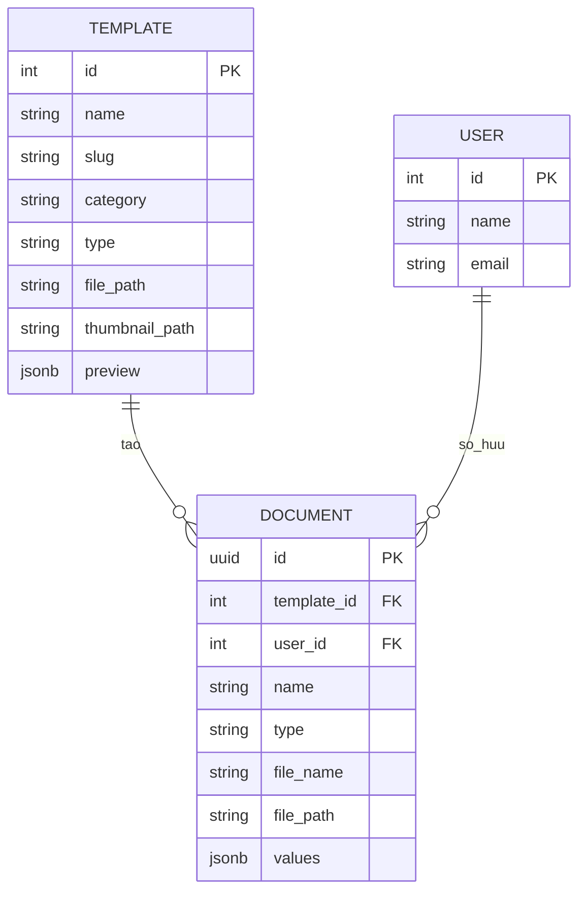

# API và mô hình dữ liệu

Mọi API nghiệp vụ có tiền tố `/api`. Khi dùng demo production, frontend gọi cùng origin qua Caddy; khi chạy local, backend mặc định ở `http://localhost:3001`.

## Endpoint chính

| Phương thức | Đường dẫn | Mục đích |
| --- | --- | --- |
| `GET` | `/health` | Kiểm tra backend |
| `GET` | `/api/templates` | Danh sách, tìm kiếm, lọc và phân trang mẫu |
| `GET` | `/api/templates/categories` | Danh mục mẫu đang hoạt động |
| `GET` | `/api/templates/:id` | Chi tiết và trường chỉnh sửa của mẫu |
| `GET` | `/api/templates/:id/preview` | Dữ liệu xem trước |
| `POST` | `/api/templates/:id/documents` | Tạo DOCX từ các trường đã khai báo |
| `POST` | `/api/templates/:id/copies` | Tạo bản PPTX độc lập; có thể thay placeholder |
| `GET` | `/api/documents` | Danh sách tài liệu của Demo User |
| `GET` | `/api/documents/:uuid` | Metadata công khai của tài liệu |
| `GET` | `/api/files/:uuid` | Tải file đã tạo |
| `POST` | `/api/templates` | Tải DOCX mới lên (`multipart/form-data`) |
| `POST` | `/api/templates/presentations` | Tải PPTX mới lên (`multipart/form-data`) |
| `PATCH` | `/api/templates/:id` | Sửa tên, mô tả hoặc danh mục |
| `DELETE` | `/api/templates/:id` | Ẩn mẫu khỏi thư viện, giữ file nguồn |

Tạo DOCX/PPTX nhận JSON dạng `{ "values": { "field_key": "Nội dung" } }`. Upload nhận các trường `file`, `name`, `description`, `category`. Response tạo file tương thích frontend:

```json
{
  "id": "uuid",
  "fileName": "tai-lieu.docx",
  "downloadUrl": "/api/files/uuid"
}
```

Danh sách mẫu trả `{ items, meta }`. Metadata tài liệu không tiết lộ đường dẫn filesystem nội bộ.

## Mô hình dữ liệu



`Template` và `User` dùng ID số nguyên; `Document` dùng UUID. PostgreSQL giữ metadata; file mẫu và file tạo ra nằm ở các thư mục storage riêng. Migration chạy khi backend khởi động; không bật TypeORM `synchronize`.

## Thư viện và giấy phép

Các thư viện chính: Next.js, React, NestJS, TypeORM, `pg`, `docx`, `pptxgenjs` (MIT); TypeScript, RxJS, `reflect-metadata` (Apache-2.0); `dotenv` (BSD-2-Clause). JSZip được phát hành theo MIT hoặc GPL-3.0-or-later. Xem dependency đã khóa trong `package-lock.json` trước khi phân phối.
